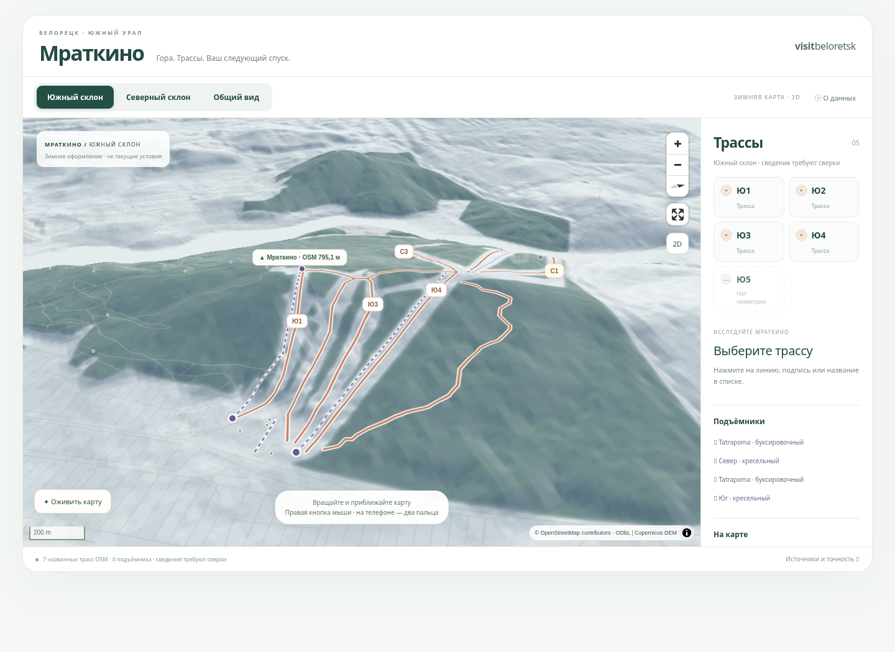

# Мраткино — живая интерактивная 3D-карта

Одна непрерывная WebGL-карта на **MapLibre GL JS 6.15.0**: свободное вращение,
наклон, перемещение и масштабирование. Кнопки склонов плавно меняют камеру той
же карты. Статичные изображения используются только как явно обозначенный
резерв при ошибке WebGL/загрузки. Старый прототип сохранён отдельно.

## Редизайн: предварительный вид



[Северный склон](renders/live-north.png) · [Общий вид](renders/live-overview.png) ·
[Телефон](renders/live-mobile.png) · [Отчёт и публикация](REDESIGN.md)

Живая карта опубликована: **https://poletavkinvladislav2025-dot.github.io/mratkino-3d-map/**.
GitHub Pages включён владельцем; проверен HTTP 200. При обновлении `main`
GitHub Actions пересобирает сайт автоматически. Текущий этап развития описан
в [LIVING_SCENE.md](LIVING_SCENE.md).

## Как посмотреть сейчас

**Без установки и без хостинга:** скачайте `deliverables/mratkino-3d.html` и
откройте в современном браузере с WebGL2. Внутри находятся движок, worker,
реальные высотные тайлы и все слои — сетевых запросов не требуется. Размер
около 10 МБ; это демонстрационная автономная версия, не рекомендуемый способ
загрузки карты на мобильном сайте.

Полное содержимое документа проверяется в Chromium с отключённой сетью.
В облачном Chromium прямой переход к `file://` запрещён политикой среды;
это ограничение браузера среды, а не требование карты к хостингу.

**Разработка и тестирование:**

```sh
cd /workspace/mratkino-3d-map
npm ci
npm run dev -- --port 5173 --strictPort
```

Откройте адрес, который напечатает Vite. Нужен Node.js 20.19+ или 22.12+
(проверено на 24.19.0). Ключи API, платные подписки и серверная часть не нужны.
Ветка редизайна — `feature/mratkino-redesign`. Предыдущая рабочая версия: `c049689`.
Подробности изменений и публикации: [REDESIGN.md](REDESIGN.md).

## Что реально нанесено

- Настоящий Copernicus GLO-30, вертикальное усиление **1** и теневая отмывка.
- 7 названных линий OSM: Ю1–Ю4 и С1–С3. **Ю5 не найдена**.
- 8 линейных и 7 площадных объектов спусков всего. Полигон и линия могут
  описывать один спуск: это не 15 отдельных трасс.
- 4 подъёмника, 4 станции и 16 опор, отдельный включаемый слой.
- 36 масок леса из OSM, без случайного леса и отдельных 3D-деревьев.
- Дороги, здания и объекты инфраструктуры; включаемые горизонтали каждые 25 м.

Все объекты OSM помечены **не сверено курортом**. У Ю3 есть противоречие:
`name=Ю3`, `ref=Ю2`; оно не исправлено по догадке. Длина, перепад и сложность
не выдаются за подтверждённые. Вычисленная длина линии OSM отдельно подписана
как геометрическая. Цвет выделения не является категорией сложности.
Подробности, лицензии и перечень исходных ID — [DATA_SOURCES.md](DATA_SOURCES.md).

## Управление

- Мышь: перетаскивание — сдвиг; правая кнопка или Ctrl + перетаскивание —
  вращение и наклон; Ctrl + колесо — масштаб. Кнопки +/− и компас штатные.
- Клавиатура при фокусе карты: +/−, стрелки; Shift + стрелки — наклон/поворот.
- Телефон: два пальца для карты; одним пальцем прокручивается страница.
  Двухпальцевый поворот и прокрутка страницы одним пальцем проверяются в touch-эмуляции Chromium; физические устройства требуют отдельной проверки.
- Северный/Южный склон и общий вид — разовый плавный переход, не автоповорот.
  Начало ручного жеста останавливает анимацию. При reduced-motion переход мгновенный.
- Выбор трассы — линия, подпись или строка списка. «Показать трассу» приближает
  камеру по её реальной геометрии. На телефоне информация в раскрывающейся панели.
- Полный экран использует MapLibre (с CSS-резервом, если fullscreen API недоступен).
  2D/3D меняет наклон той же карты.

## Данные и воспроизводимость

GIS-окружение текущей среды: `/workspace/mratkino-gis/bin/python`.
В другом окружении:

```sh
python -m venv .venv
. .venv/bin/activate
python -m pip install -r requirements-gis.txt
```

Для повторной подготовки из существующих исходников:

```sh
python scripts/download_live_osm.py
python scripts/prepare_web_data.py
python scripts/prepare_winter_forest.py
```

Первая команда использует уже сохранённый XML. **Только для намеренного обновления**:
`python scripts/download_live_osm.py --refresh`. Предыдущая версия сохраняется
по хешу в `data/raw/history/`. API — read-only, изменения в OSM не отправляются.

`prepare_web_data.py` читает реальные исходные GeoTIFF Copernicus
`data/dem/Copernicus_DSM_COG_*_DEM.tif`, а также старую метрическую сетку
`data/terrain.json` для горизонталей. Они сохранены в текущей среде. При их
отсутствии сначала выполните прежние `scripts/download_data.py` и
`scripts/prepare_terrain.py`; они описаны в архивной документации и содержат
поддержку ручного GeoTIFF. Не подменяйте недостающие высоты тестовыми данными.

Исходники:

| Путь | Содержимое |
| --- | --- |
| `src/mratkino-map.js` | Изолированный Web Component, камера, выбор трасс, жесты и fallback |
| `src/map-data.js` | Чистая логика геометрии/камеры и зимний стиль MapLibre |
| `src/component.css` | Стили компонента внутри Shadow DOM |
| `scripts/download_live_osm.py` | Ограниченная read-only выгрузка официального OSM API |
| `scripts/prepare_web_data.py` | Terrarium XYZ, реальные GeoJSON и горизонтали |
| `scripts/export_standalone.mjs` | Автономный HTML и Tilda-файлы |
| `public/live/` | 40 DEM-тайлов z10–14, GeoJSON, manifest и лицензии |
| `data/raw/osm-resort-map.xml` | Сохранённые исходные узлы/линии/отношения OSM |
| `archive/static-prototype/` | Прежние интерфейс, стили и тесты статичных ракурсов |
| `blender/`, `renders/`, старые GIS-скрипты | Сохранённый первый этап, не загружается в живую карту |

## Сборка и Tilda

```sh
npm run build
npm run preview -- --port 4173 --strictPort
npm run build:standalone
python scripts/package_delivery.py
```

`dist/` — готовый статический сайт. Blender-сцена, исходные GeoTIFF и прежние
рендеры в него не включаются. MapLibre грузится лениво, только когда блок
приближается к экрану. Карта запрашивает DEM-тайлы только района, не весь мир.
Плотность canvas ограничена 1.5× для мобильной нагрузки. Внешние шрифты,
платные API и базовая карта стороннего сервиса не запрашиваются.

Файлы в `deliverables/`:

- `mratkino-3d.html` — самостоятельный документ с живой картой, для скачивания;
- `tilda-self-contained.txt` — тот же компонент и встроенные данные для T123;
  он большой (около 10 МБ), непосредственно в редакторе Tilda пока не проверен;
- `tilda-iframe.txt` — компактный рекомендуемый вариант T123;
- `mratkino-web.zip` — архив production-сайта для HTTPS-хостинга (после упаковки).

GitHub Actions workflow при обновлении `main` собирает и публикует `dist/`
через GitHub Pages. Источник **GitHub Actions** включён владельцем.
Адрес: `https://poletavkinvladislav2025-dot.github.io/mratkino-3d-map/`.

Короткий iframe находится в `public/tilda-embed.html` и `deliverables/tilda-iframe.txt`.
Вставьте его в T123 тестовой страницы. Обновления `main`
не потребуют повторного копирования большого кода. Для другого хостинга разместите
содержимое `dist/` и замените адрес iframe. Относительные пути сохранены (`base: './'`).

Компонент использует Shadow DOM: стили не конфликтуют с Tilda, JS не добавляет
объекты в `window`. Повторное подключение создаёт новую карту с очисткой старой,
ResizeObserver отслеживает размер блока. Если используется не iframe, а весь
самодостаточный код, вставляйте его один раз в T123 на тестовой странице;
готовность редактора принять большой код и требования CSP проверяйте там.
Опубликованный сайт Visit Beloretsk не изменялся.

## Проверки

```sh
npm run test:unit
npm test
python -m unittest discover -s tests -p 'test_*.py' -v
```

Playwright — Chromium `/usr/bin/chromium`, при необходимости задайте
`CHROMIUM_PATH`. В облаке используется программный WebGL SwiftShader;
проверка кадров не является замером FPS физического телефона.
Восемь браузерных сценариев проверяют реальную высоту вершины, отрисованные трассы, вращение и
наклон, камеру склонов, прерывание перехода, выбор и предупреждения, слои,
мобильную компоновку, fallback и повторное подключение компонента.

Скриншоты: `renders/live-overview.png`, `live-south.png`, `live-north.png`,
`live-mobile.png`. Для автономного файла отдельно проверяется работа содержимого
при отключённой сети и без веб-origin; встроенный worker собран в classic IIFE
для совместимости с таким просмотром. Архивные Blender/GIS-тесты сохраняются, но не заменяют
проверку живого WebGL-режима.

## Если нельзя скачать большой HTML

`python scripts/export_browser_lite.py` создаёт HTML примерно 12 КБ,
`deliverables/mratkino-browser-lite.html`: его можно целиком скопировать в
текстовый редактор и сохранить как .html. Нужен интернет. MapLibre 5.13.0 UMD
загружается с jsDelivr, реальные высоты — Mapterhorn (maxzoom 12), лес —
OpenFreeMap. Семь названных линий трасс и четыре подъёмника встроены из OSM.
Проверены отрисовка, высота вершины около 796.6 м и северный ракурс. Это отдельный
малый просмотрщик, а не замена основного проекта на MapLibre 6.

## Объёмная иллюстративная сцена

Нажмите «Оживить карту»: взрослые ели внутри лесных полигонов, молодые ели
на С1 по сообщению владельца, открытые кресла с пассажирами и бугели на четырёх
исходных линиях подъёмников. «Пауза» останавливает движение, не скрывая модели.
Кнопка «Рассмотреть в 3D» в карточке подъёмника показывает крупный план.
На телефоне моделей меньше. Three.js загружается только после включения сцены.
Полные условности и оставшиеся этапы: [LIVING_SCENE.md](LIVING_SCENE.md).
